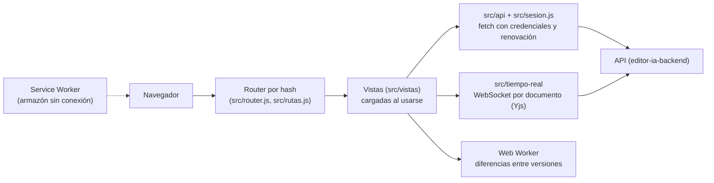

# editor-ia-frontend: la aplicación web de Cuaderno

**Producción:** <https://cuaderno.jonarproyectos.com>

Este repositorio es la parte visible de **Cuaderno**, el editor colaborativo de documentación técnica
con IA: documentos, editor en tiempo real, historial, comentarios, asistente de IA, cuenta y
administración. La **guía completa para evaluar el proyecto** (acceso, roles y la prueba de cada
función paso a paso) está en el README principal, en
[editor-ia-backend](https://github.com/Jonar519/editor-ia-backend#readme). Aquí se explica lo propio
del frontend.

## Contenido

1. [Qué es](#1-qué-es)
2. [Cómo funciona](#2-cómo-funciona)
3. [Tecnologías](#3-tecnologías)
4. [Qué se necesita](#4-qué-se-necesita)
5. [Acceso y roles](#5-acceso-y-roles)
6. [Guía de pruebas](#6-guía-de-pruebas)
7. [Pruebas automatizadas](#7-pruebas-automatizadas)
8. [Limitaciones y decisiones de diseño](#8-limitaciones-y-decisiones-de-diseño)
9. [Solución de problemas](#9-solución-de-problemas)
10. [Estructura del repositorio](#10-estructura-del-repositorio)
11. [Glosario](#11-glosario)

## 1. Qué es

Una aplicación de una sola página (SPA) en **JavaScript sin framework**, con Vite, que habla con la API
de [editor-ia-backend](https://github.com/Jonar519/editor-ia-backend). Incluye:

- **Documentos**: espacios, documentos y búsqueda por significado.
- **Editor colaborativo** (CodeMirror 6 + Yjs): presencia con nombre y color, edición sin conexión,
  comentarios anclados, paleta de comandos, vista previa con fórmulas y código.
- **Historial de versiones**: guardar, comparar (en un Web Worker), restaurar y verificar la cadena.
- **Asistente de IA**: explicar, resumir, mejorar como propuesta, sugerencias mientras escribes.
- **Cuenta**: perfil, foto, correo, contraseña, verificación en dos pasos, sesiones, datos y
  eliminación. **Administración**: invitaciones.

## 2. Cómo funciona

Archivos estáticos (HTML, CSS y JavaScript) servidos por Vercel. Los datos llegan de la API
(`VITE_API_URL`, otro origen del mismo sitio) con `fetch` y credenciales, y la edición en vivo por un
WebSocket por documento. Un **router por hash** elige la pantalla y carga su código solo cuando hace
falta:

| Ruta                                                                   | Pantalla                                         | Quién                          |
| ---------------------------------------------------------------------- | ------------------------------------------------ | ------------------------------ |
| `#/` · `#/entrar`                                                      | Portada e inicio de sesión                       | Cualquiera                     |
| `#/recuperar` · `#/recuperar/<token>`                                  | Pedir y usar el enlace de recuperación           | Cualquiera (con el enlace)     |
| `#/invitacion/<token>`                                                 | Crear la cuenta invitada                         | Con el enlace del correo       |
| `#/correo/<token>`                                                     | Confirmar un cambio de correo                    | Con el enlace del correo       |
| `#/cuenta-eliminada`                                                   | Aviso tras eliminar la cuenta                    | Cualquiera                     |
| `#/documentos` · `#/documentos/<id>` · `#/documentos/<id>/versiones`   | Espacios y documentos, lectura e historial       | Toda cuenta (Lectura o más)    |
| `#/cuenta` y `#/cuenta/foto`, `/correo`, `/contrasena`, `/dos-pasos`, `/sesiones`, `/datos` | Tu cuenta                  | Toda cuenta                    |
| `#/documentos/<id>/editar`                                             | Editor colaborativo                              | Edición o Administración       |
| `#/admin`                                                              | Invitaciones                                     | Administración                 |

Los tokens de los enlaces de correo se borran de la barra de direcciones al leerlos.



Puntos clave (detalle en [docs/referencia-tecnica.md](docs/referencia-tecnica.md)):

- **Sesión:** el token de acceso vive solo en memoria; al recargar se renueva con una cookie httpOnly.
- **Permisos:** la interfaz oculta lo que tu rol no puede hacer, pero quien decide es la API.
- **XSS:** la vista previa del Markdown nunca ejecuta HTML ni enlaces `javascript:`.
- **Carga diferida:** KaTeX, highlight.js y el editor se descargan solo cuando se usan; hay
  presupuestos de peso por rol que la CI comprueba.

## 3. Tecnologías

Versiones exactas del `package.json`:

| Tecnología                                           | Versión                         | Para qué se usa                                                     | Por qué se eligió                                                                 |
| ---------------------------------------------------- | ------------------------------- | ------------------------------------------------------------------- | --------------------------------------------------------------------------------- |
| **JavaScript** (módulos ES), HTML y CSS con tokens   | —                               | Toda la app, sin framework                                          | El curso evalúa DOM, eventos y asincronía directamente.                           |
| **Vite**                                             | 8.3.5                           | Desarrollo y build                                                  | Build rápido, con división del código por ruta.                                   |
| **CodeMirror 6**                                     | `@codemirror/*` 6.x             | Editor de Markdown accesible                                        | Extensible, con teclado completo.                                                 |
| **Yjs** + **y-codemirror.next** + **y-protocols**    | 13.6.33 · 0.3.6 · 1.0.7         | Edición colaborativa, presencia y trabajo sin conexión              | CRDT: todos llegan al mismo texto sin conflictos.                                 |
| **micromark / mdast** (+ GFM y matemáticas)          | ver `package.json`              | Vista previa del Markdown                                           | Análisis sin `innerHTML`; tablas, tareas, tachado y fórmulas.                     |
| **KaTeX** · **highlight.js**                         | 0.19.0 · 11.12.0                | Fórmulas y código resaltado                                         | Se cargan solo al usar la vista previa.                                           |
| **@fontsource** (Atkinson Hyperlegible Next, JetBrains Mono) | 5.3.0                   | Fuentes autoalojadas                                                | Legibles y sin pedir nada a terceros (lo exige la CSP).                           |
| **Web Workers** · **Service Worker**                 | APIs del navegador              | Diferencias entre versiones; armazón sin conexión                   | Sin bloquear la interfaz; la app abre aunque falle la red.                        |
| **Vitest** · **Playwright** + **axe**                | 5.0.4 · 1.63.0 · 4.13.0         | Pruebas unitarias; E2E en Chromium y Firefox con accesibilidad      | E2E en el contenedor oficial de Playwright para Linux.                            |
| **ESLint** · **TypeScript** (revisión de tipos)      | 10.12.0 · 6.0.3                 | Reglas y tipos sobre JavaScript                                     | La CI los exige.                                                                  |
| **Vercel** · **GitHub Actions** · **gitleaks**       | —                               | Hosting estático con cabeceras; CI y búsqueda de secretos           | Despliegue desde `main`; configuración en [`vercel.json`](vercel.json).           |

## 4. Qué se necesita

- **Para evaluarlo en producción:** solo un navegador actualizado (Chrome, Edge o Firefox). Ver
  [Qué necesita el profesor](https://github.com/Jonar519/editor-ia-backend#4-qué-necesita-el-profesor).
- **Para correrlo en local:** Node.js 24 o superior y el API corriendo en `http://127.0.0.1:4200`
  ([opción local](https://github.com/Jonar519/editor-ia-backend#b-opción-local-opcional)). Luego, en
  `cmd.exe`:

```bat
cd editor-ia-frontend
npm ci
scripts\dev.bat
```

Esperado: `Local: http://127.0.0.1:5175/`. Ábrelo con `127.0.0.1` (no `localhost`): el API solo acepta
el origen de su `APP_URL`. La app usa por defecto el API en `http://127.0.0.1:4200`; para otro, define
`VITE_API_URL` (solo el origen, sin ruta), por ejemplo:

```ini
VITE_API_URL=http://127.0.0.1:4200
```

## 5. Acceso y roles

Las cuentas se crean solo por invitación; la administración usa verificación en dos pasos
obligatoria. Permisos de la cuenta (Lectura, Edición, Administración), roles por espacio y qué hacer
si algo falla:
[Acceso y roles](https://github.com/Jonar519/editor-ia-backend#5-acceso-y-roles).

## 6. Guía de pruebas

La guía función por función está en el README principal:
[Guía de pruebas](https://github.com/Jonar519/editor-ia-backend#6-guía-de-pruebas-función-por-función).
Qué pantallas de este repositorio cubre cada bloque:

| Bloque de la guía                 | Pantallas                                                             |
| --------------------------------- | --------------------------------------------------------------------- |
| A. Portada y apariencia           | `#/` y el tema del sistema en todas                                   |
| B. Entrar y administración        | `#/entrar`, `#/admin`, `#/invitacion/<token>`                         |
| C. Espacios y documentos          | `#/documentos`, `#/documentos/<id>`                                   |
| D, E y F. Editor, tiempo real y comentarios | `#/documentos/<id>/editar`                                  |
| G. Historial de versiones         | `#/documentos/<id>/versiones`                                         |
| H. Asistente de IA                | Panel **IA** del editor y de la lectura; **Buscar por significado**   |
| I. Tu cuenta                      | `#/cuenta` y sus subpantallas, `#/recuperar`, `#/correo/<token>`, `#/cuenta-eliminada` |
| J. Robustez y seguridad           | Service Worker, almacenamiento del navegador, WebSocket               |

## 7. Pruebas automatizadas

| Comando                | Qué cubre                                                                                                                                         | Resultado esperado                                          |
| ---------------------- | ------------------------------------------------------------------------------------------------------------------------------------------------- | ----------------------------------------------------------- |
| `scripts\test.bat`     | 432 pruebas unitarias: sesión, router, editor, convergencia, anclas de comentarios, XSS de la vista previa, IA, CSP, Service Worker…               | `Tests 432 passed (432)` en 24 archivos.                    |
| `scripts\revisar.bat`  | Auditoría de significado de color, contraste AA (128 pares en los dos temas) y presupuestos de peso por rol                                       | Todo en verde (`Contraste AA: 128 de 128 pares cumplen.`).  |
| `scripts\mutar.bat`    | 128 reglas críticas rotas a propósito (token fuera de la URL, un solo refresco a la vez, el SW nunca cachea `/api`, API en otro origen…)          | `Detectadas 128, sobreviven 0`.                             |
| `scripts\e2e.bat`      | Playwright + axe en Chromium y Firefox, en el contenedor oficial de Linux                                                                         | Todas en verde (223 en la última corrida local).            |
| `scripts\ci.bat`       | Todo lo anterior más lint, typecheck, build, `npm audit` y gitleaks                                                                               | `RESULTADO: OK`.                                            |

## 8. Limitaciones y decisiones de diseño

- **Sin framework y sin selector de tema:** a propósito; el tema lo decide el sistema operativo.
- **Miembros y permisos sin pantalla:** agregar miembros a un espacio, transferir y dar permisos por
  documento se hacen por la API (ver la
  [guía principal](https://github.com/Jonar519/editor-ia-backend#8-limitaciones-conocidas-y-decisiones-de-diseño)).
- **La CSP completa va en el `<meta>` del build** y `frame-ancestors 'none'` como cabecera en
  `vercel.json`; no hay nonce.
- **Sin medir:** Safari y algunos casos con fotos reales en Firefox están declarados como no medidos en
  [docs/revision-bloque-R.md](docs/revision-bloque-R.md).

## 9. Solución de problemas

| Síntoma                                               | Qué hacer                                                                                                                  |
| ----------------------------------------------------- | -------------------------------------------------------------------------------------------------------------------------- |
| "Conexión: Sin conexión. Reintentando…"                | La API no responde o la red bloquea WebSockets; lo escrito se guarda y se envía al volver.                                  |
| La app muestra una versión vieja                      | El Service Worker sirve el armazón anterior: recarga con Ctrl+F5 o cierra y abre la pestaña.                               |
| Local: errores de CORS u "origen no permitido"        | Abre `http://127.0.0.1:5175` (no `localhost`) y revisa que `APP_URL` del backend sea exactamente ese origen.                |
| El build de Vercel falla por `VITE_API_URL`           | En Vercel es obligatoria y debe ser `https://`, solo el origen.                                                            |
| `scripts\e2e.bat` no arranca                          | Docker Desktop debe estar encendido: las E2E corren en el contenedor de Playwright.                                        |

Más síntomas del proyecto completo:
[Solución de problemas](https://github.com/Jonar519/editor-ia-backend#9-solución-de-problemas).

## 10. Estructura del repositorio

```
editor-ia-frontend/
├── index.html · public/        # documento base y archivos estáticos
├── src/
│   ├── main.js · router.js · rutas.js   # arranque, router por hash y tabla de rutas
│   ├── sesion.js · api/        # sesión (token en memoria, renovación) y cliente de la API
│   ├── vistas/                 # publico/, lector/, editor/ y admin/
│   ├── tiempo-real/            # WebSocket del documento (Yjs) y presencia
│   ├── comentarios/ · diff/    # anclas de comentarios y diferencias entre versiones (Web Worker)
│   ├── markdown/ · diferidas/  # vista previa y módulos que se cargan al usarse (KaTeX, highlight.js)
│   ├── componentes/            # estados, formularios, avisos, anuncios para lectores de pantalla
│   ├── sw/                     # Service Worker
│   └── estilos/                # tokens de color y estilos
├── tests/unitarias · tests/e2e
├── mutations/                  # catálogo de mutaciones
├── scripts/                    # dev, test, e2e, revisar, mutar, ci, gitleaks
├── docs/                       # referencia técnica, demos H1–J, revisión del bloque R
├── vite.config.js · vercel.json · presupuestos.json
└── package.json
```

## 11. Glosario

| Término             | Qué significa aquí                                                                                         |
| ------------------- | ---------------------------------------------------------------------------------------------------------- |
| **SPA**             | Aplicación de una sola página: carga una vez y cambia de pantalla sin recargar.                            |
| **Router por hash** | Elige la pantalla según lo que va después de `#` en la dirección.                                         |
| **CRDT / Yjs**      | Estructura que permite editar a la vez y llegar siempre al mismo texto; Yjs es la implementación.          |
| **CSP**             | Cabecera que limita de dónde carga scripts la página y a qué servidores se conecta.                        |
| **Presupuesto de peso** | Tamaño máximo de JavaScript y CSS que puede descargar cada rol; la CI lo comprueba.                     |
| **Contraste AA**    | Nivel de las pautas de accesibilidad WCAG para que el texto se lea bien sobre su fondo.                   |

El glosario completo está en el
[README principal](https://github.com/Jonar519/editor-ia-backend#11-glosario).
